# Animated SVG Spinners

46 spinners animated with SMIL, the same 46 animated with CSS, and 12 loaders. Each set is split into what should move now, what doesn't yet and why, and what is still by design.

## SVG Spinners, SMIL

### Animated (22)

     

     

     

   

### Not animated yet (24)

These start one animation from another's beginning or end (`begin="a.end"`), or from a tap or hover. The iOS player doesn't do that yet, so some or all of each stays still. They should move once it does.

     

     

     

     

## SVG Spinners, CSS

The same shapes again, driven by `@keyframes` instead.

### Animated (46)

     

     

     

     

     

     

     

   

## SVG Loaders

White on transparent.

### Animated (12)

     

     

## Credits

- [SVG Spinners](https://github.com/n3r4zzurr0/svg-spinners) by Utkarsh Verma, MIT (`assets/licences/SVG Spinners.txt`)
- [SVG Loaders](https://github.com/SamHerbert/SVG-Loaders) by Sam Herbert, MIT (`assets/licences/SVG Loaders.txt`)
