# Animated SVG W3C Tests

The 74 animation tests from the W3C SVG 1.1 Second Edition test suite that use no script (`animate-*`). Each was written for a browser: many say what a pass looks like in the image itself, often at a given second, and some rely on fonts or events a document view doesn't have. A coverage reference, not a pass list.

### animate-elem-02-t


### animate-elem-03-t


### animate-elem-04-t


### animate-elem-05-t


### animate-elem-06-t

### animate-elem-07-t


### animate-elem-08-t


### animate-elem-09-t


### animate-elem-10-t

### animate-elem-11-t


### animate-elem-12-t

### animate-elem-13-t


### animate-elem-14-t


### animate-elem-15-t

### animate-elem-17-t

### animate-elem-19-t


### animate-elem-20-t

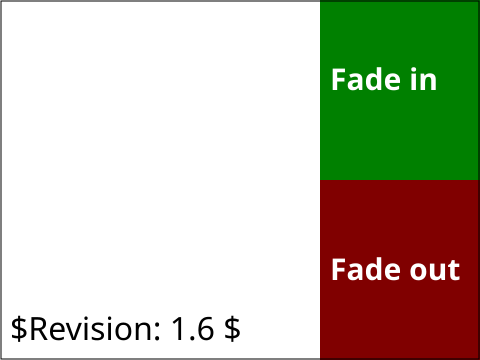

### animate-elem-21-t


### animate-elem-22-b


### animate-elem-23-t

### animate-elem-24-t

### animate-elem-25-t


### animate-elem-26-t


### animate-elem-27-t


### animate-elem-28-t


### animate-elem-29-b


### animate-elem-30-t


### animate-elem-31-t

### animate-elem-32-t

### animate-elem-33-t


### animate-elem-34-t


### animate-elem-35-t


### animate-elem-36-t

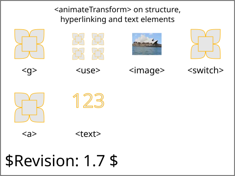

### animate-elem-37-t

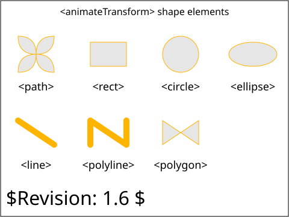

### animate-elem-38-t

### animate-elem-39-t

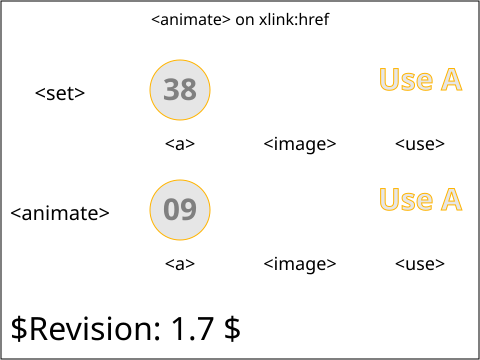

### animate-elem-40-t

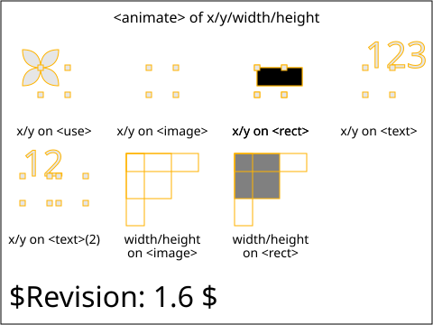

### animate-elem-41-t


### animate-elem-44-t


### animate-elem-46-t


### animate-elem-52-t


### animate-elem-53-t


### animate-elem-60-t

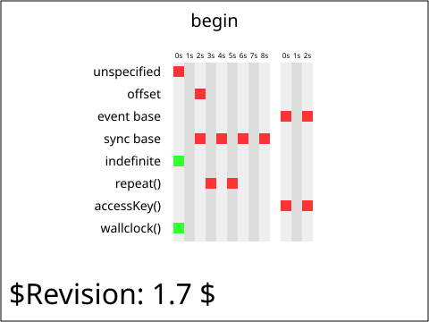

### animate-elem-61-t

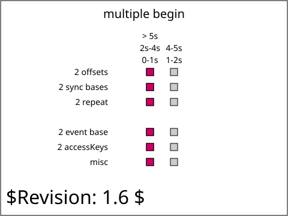

### animate-elem-62-t

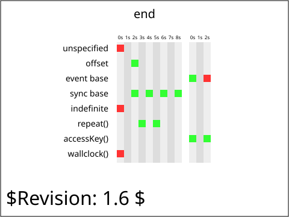

### animate-elem-63-t

### animate-elem-64-t

### animate-elem-65-t

### animate-elem-66-t

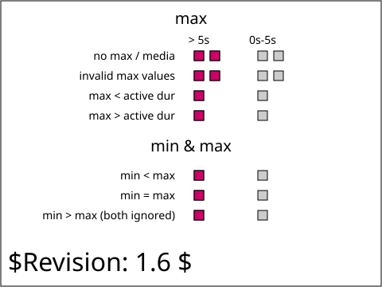

### animate-elem-67-t

### animate-elem-68-t

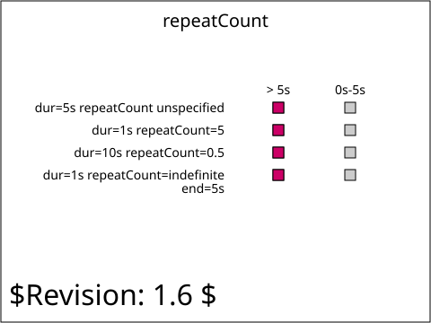

### animate-elem-69-t

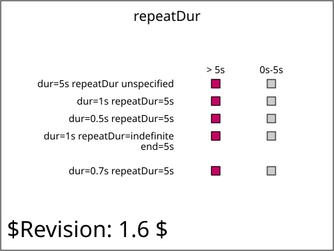

### animate-elem-70-t


### animate-elem-77-t

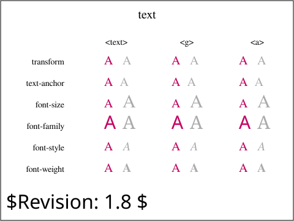

### animate-elem-78-t

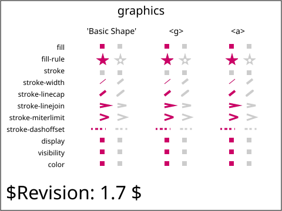

### animate-elem-80-t


### animate-elem-81-t


### animate-elem-82-t


### animate-elem-83-t


### animate-elem-84-t

### animate-elem-85-t


### animate-elem-86-t


### animate-elem-87-t


### animate-elem-88-t

### animate-elem-89-t


### animate-elem-90-b

### animate-elem-91-t


### animate-elem-92-t

### animate-interact-events-01-t

### animate-interact-pevents-01-t

### animate-interact-pevents-02-t

### animate-interact-pevents-03-t

### animate-interact-pevents-04-t

### animate-pservers-grad-01-b

## Credits

- [W3C SVG 1.1 Second Edition test suite](https://www.w3.org/Graphics/SVG/Test/20110816/), W3C 3-clause BSD licence (`assets/licences/W3C.txt`); each file keeps its own copyright notice
