# Animated SVG Weather, line

All 475 Meteocons weather icons in the line style, animated with SMIL. A stress test: only what is on screen should be drawing. The still ones are at the end: flags, units and the like, which Meteocons draws still (its "not available" icon, a crossed-out N/A, among them).

### Animated (447)

    

    

    

   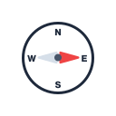 

    

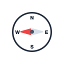    

  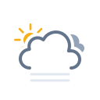  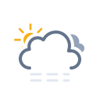

    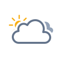

    

    

    

    

    

   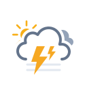 

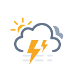    

  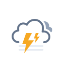  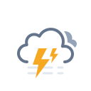

   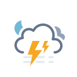 

    

    

   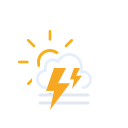 

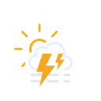    

    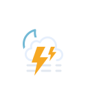

    

    

    

    

    

    

    

    

    

    

    

    

    

    

    

    

    

    

    

    

    

    

    

    

    

    

    

    

    

    

    

    

    

    

    

    

    

    

    

    

    

    

    

    

    

    

    

    

    

    

    

    

    

    

    

    

    

    

    

    

    

    

    

    

    

    

    

 

### Still by design (28)

Drawn still by their author: there is nothing in these files to animate, so they should not move.

    

    

    

    

    

  

## Credits

- [Meteocons](https://github.com/basmilius/weather-icons) by Bas Milius, MIT (`assets/licences/Meteocons.txt`)
