# Animated SVG

Animated SVGs as a README shows them, in HTML `` tags. Everything below should move, except the three in **Out of scope**, which test that a renderer does not run script or react to a tap or hover (GitHub doesn't either).

Larger sets, for stress and coverage: `Animated SVG Spinners`, the four `Animated SVG Weather` bundles and `Animated SVG W3C Tests`.

## Weather

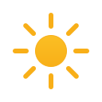   

   

   

## Spinners

     

     

## Loaders

These are white on transparent: on a light page they are hard to see, which is part of the test.

     

     

## Feature tests

Each names the feature it uses and what should be seen. A still frame is a failure, except where it says so.

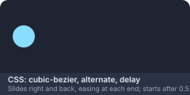

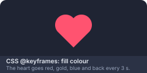

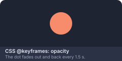

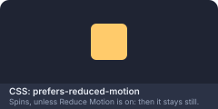

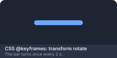

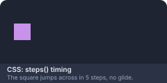

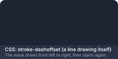

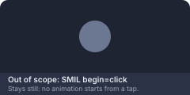

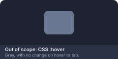

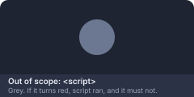


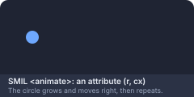


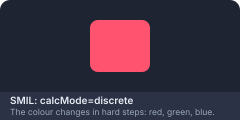

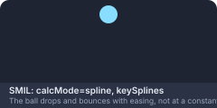

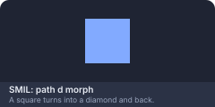

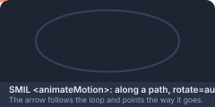


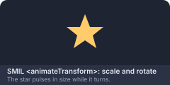

## Credits

- [Meteocons](https://github.com/basmilius/weather-icons) by Bas Milius, MIT (`assets/licences/Meteocons.txt`)
- [SVG Spinners](https://github.com/n3r4zzurr0/svg-spinners) by Utkarsh Verma, MIT (`assets/licences/SVG Spinners.txt`)
- [SVG Loaders](https://github.com/SamHerbert/SVG-Loaders) by Sam Herbert, MIT (`assets/licences/SVG Loaders.txt`)

The feature tests were written for this repository.
