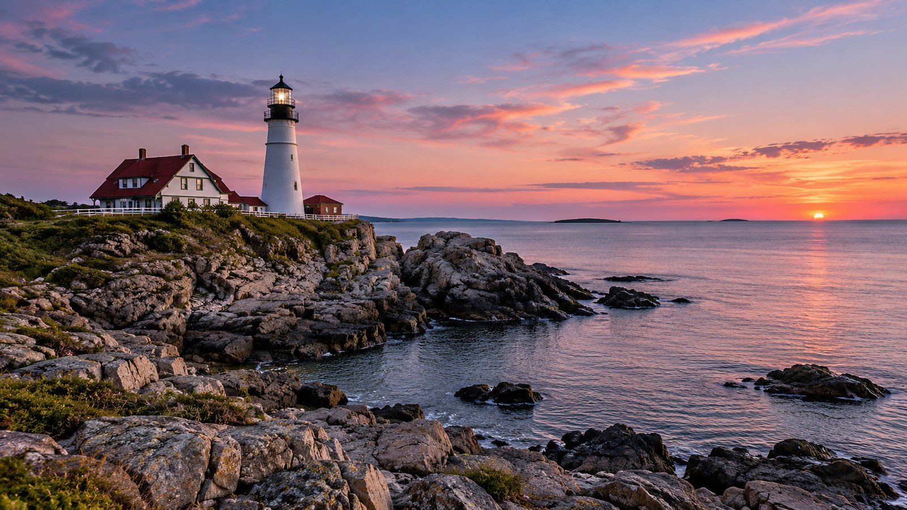

# The Last Keepers

For more than a century, the light on the headland was kept by hand. Three keepers lived in the cottages below it, taking the night in watches: trimming the wick, winding the clockwork that turned the lens, and writing up the log at the end of each watch.

The last of them left in the spring of the year the light was automated. The lens still turns, but nobody climbs the hundred and twelve steps at dusk any more.

## A night's watch

The first watch began at sunset. The keeper lit the lamp, started the clockwork, and checked the light from the gallery before settling in the watch room with the log. Every two hours the weights had to be wound back up, and every hour the weather was written down: the wind, the sea, and how far the light could be seen.

## What is left

The cottages are holiday lets now. The log books went to the county archive, where anyone can read them: page after page of wind directions, the odd ship's name, and once, in pencil in the margin, *saw the whales again tonight*.
