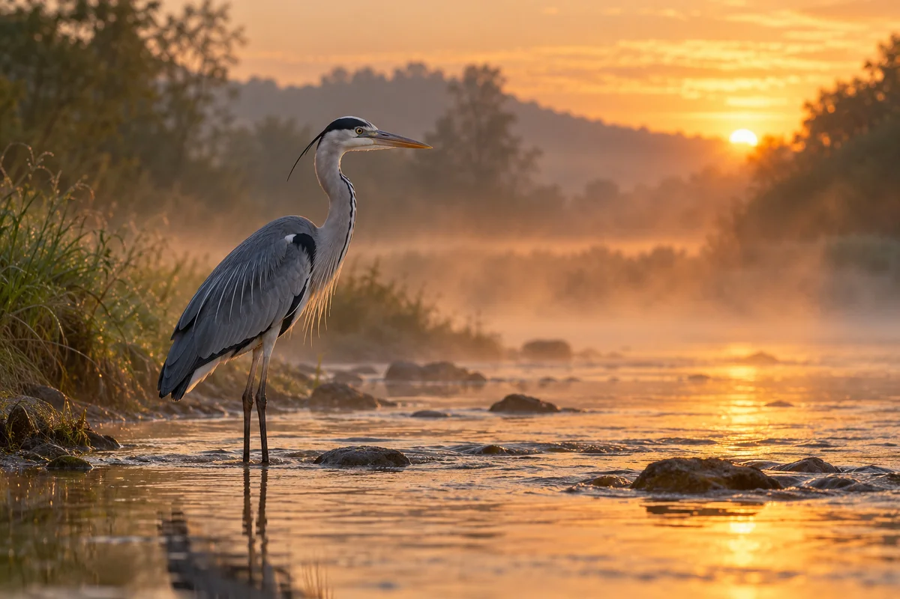
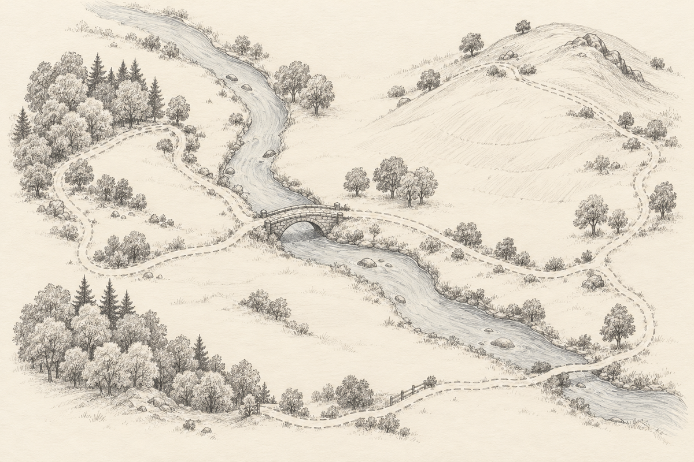

# Field Notes: the river walk

*Saturday, early.* Out of the door before six, with the mist still lying on the water meadows. The path follows the river for the first two miles, then climbs to the wall and the stile.

The heron was there again, in the same shallows below the weir, as still as a post. It let me get within twenty yards before it lifted off, legs trailing, and settled again further down.

## Along the bank

- Ferns just unfurling under the alders, the fronds still tight as fists.
- Meadowsweet not out yet. Another fortnight, perhaps.
- A kingfisher, a flash of blue, gone before I could look properly.

## The wall

The dry-stone wall by the stile is more moss than stone now. Someone has rebuilt the top course since last year: the new stones are paler and have nothing growing on them yet.

| Mile | Where | Time |
|---:|---|---|
| 0 | Front door | 05:50 |
| 2 | Weir | 06:35 |
| 3 | Stile and wall | 07:05 |
| 5 | Bridge, and home | 08:10 |

## The route

I drew the route when I got back, so I can find the far bridge again.

- [x] Weir
- [x] Stile
- [ ] The far bridge (next time)

> Notes to self: start earlier, bring the long lens, and look for the kingfisher below the bridge, not above it.

The heron again, on the way home, as if it hadn't moved all morning:

